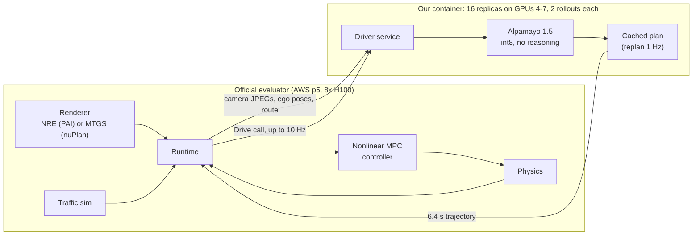
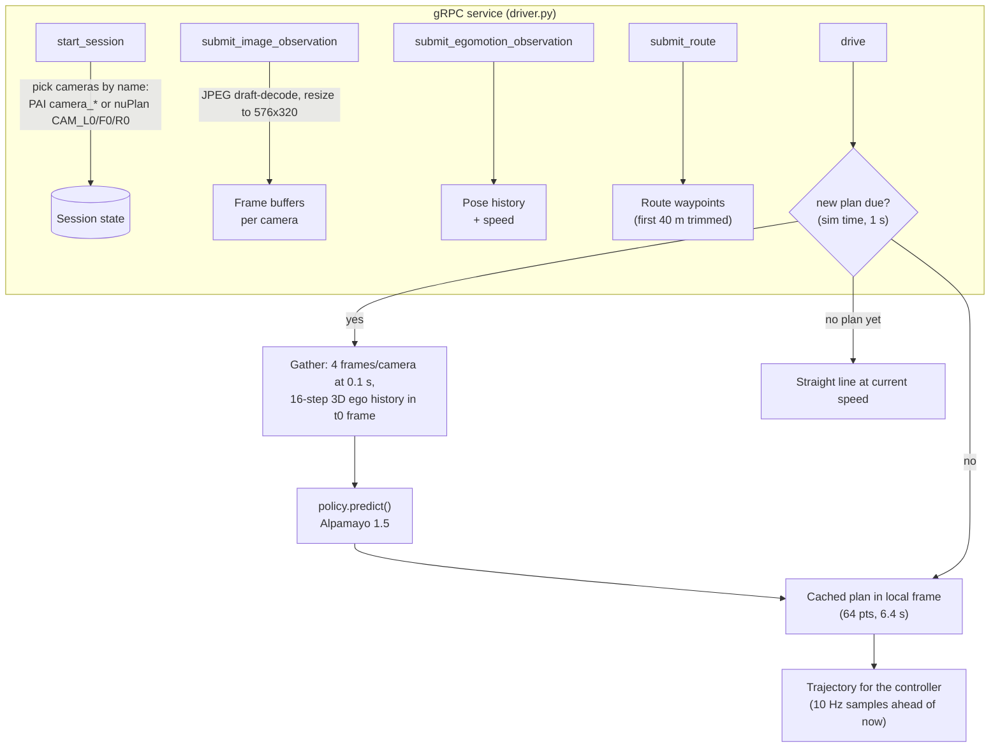
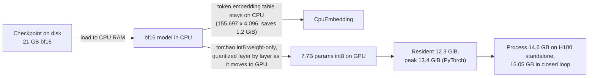
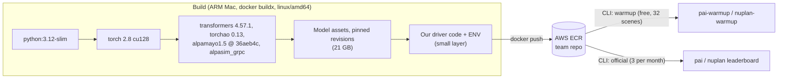
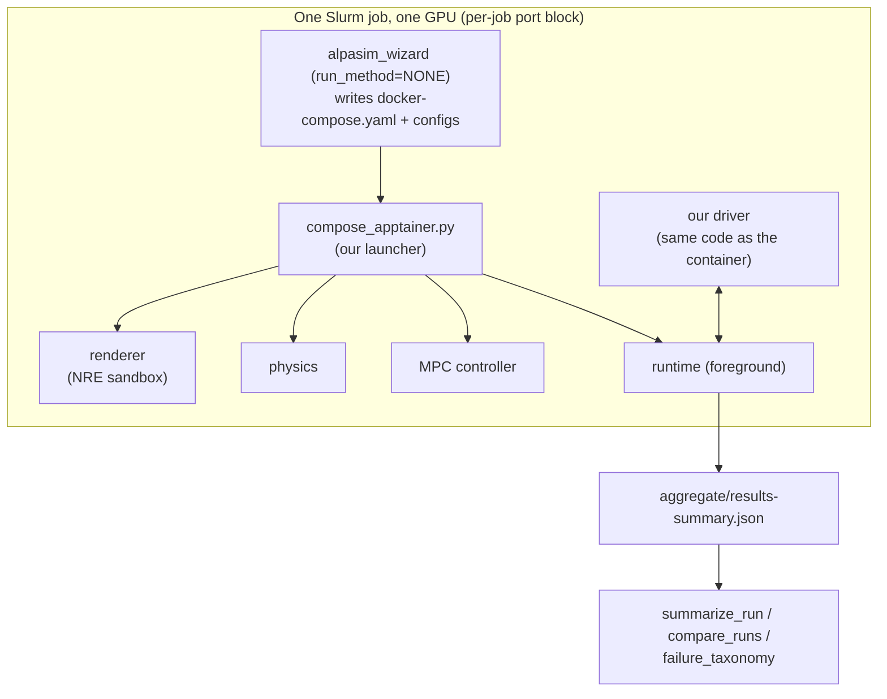
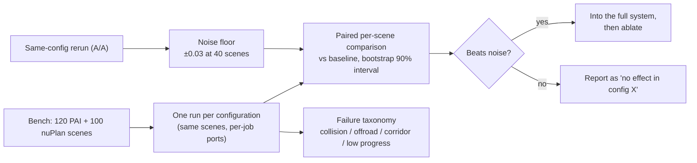
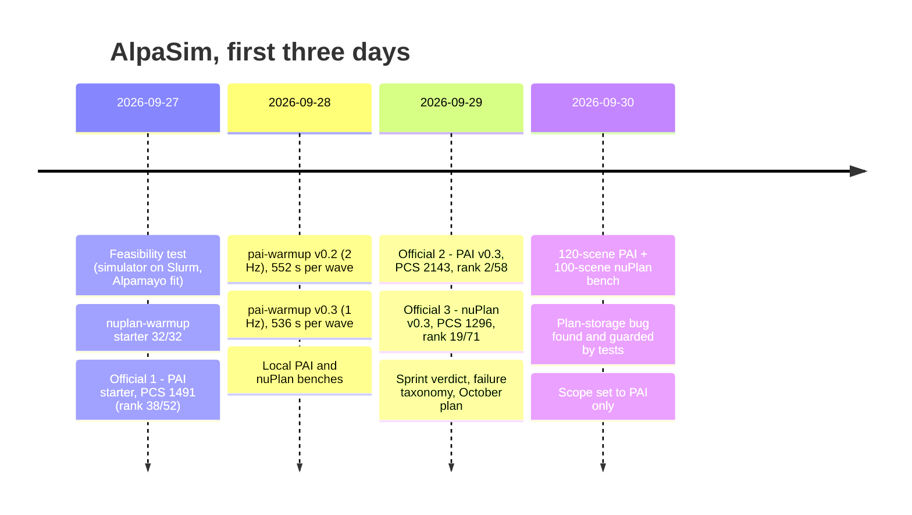

# AlpaSim E2E Closed-Loop Challenge 2026: team amanupg

Our entry for the [NVIDIA AlpaSim E2E Closed-Loop Challenge](https://huggingface.co/spaces/nvidia/AlpasimE2EClosedLoopChallenge2026).
Every number below comes from [`LEDGER.md`](LEDGER.md), the measurement log; this README is the map.
[`PLAN.md`](PLAN.md) holds the October research plan.
This is a **separate project** from our nuReasoning entry: [`BORROWED.md`](BORROWED.md) lists
exactly what it reads from nuReasoning (read-only).

**Scope (from 2026-09-30): the PAI track only, with Alpamayo 1.5.** The nuPlan track moved to a
separate JEPA thread (`../alpasim-jepa`, another agent). Our nuPlan results and diagnosis stay below
and in the ledger as history. October's 3 official slots are shared by both threads: up to 2 for PAI.

**Standing, as of 2026-09-29** (the leaderboard is open until 2026-10-31):

| Track | Entry | PCS | Rank | Avg scene score | At-fault incident spacing |
|---|---|---|---|---|---|
| PAI | v0.3 (Alpamayo 1.5 int8, 1 Hz) | **2143** | **2 / 58** | 0.611 | **0.795** (best in the top 6) |
| nuPlan | v0.3 | 1296 | 19 / 71 | 0.827 | 0.234 |
| PAI | v0.1 starter (straight line, current speed) | 1468 | 43 / 58 | 0.140 | 0.143 |

Contents
1. [The challenge](#1-the-challenge)
2. [Our driver](#2-our-driver)
3. [Fitting a 10B model into 16 GiB](#3-fitting-a-10b-model-into-16-gib)
4. [Container and submission pipeline](#4-container-and-submission-pipeline)
5. [Running the official simulator on a Slurm cluster](#5-running-the-official-simulator-on-a-slurm-cluster)
6. [How we measure](#6-how-we-measure)
7. [Experiments so far](#7-experiments-so-far)
8. [Timeline and submissions](#8-timeline-and-submissions)
9. [Where things live](#9-where-things-live)

---

## 1. The challenge

We submit a **driver container**. The organisers' simulator renders camera images from
neurally reconstructed real-world scenes, calls our gRPC `Drive` method, sends our trajectory
to a fixed nonlinear MPC controller, and the world reacts. It is closed loop: our mistakes
change what we see next.

| | PAI track | nuPlan track |
|---|---|---|
| Scenes | NVIDIA NuRec reconstructions, 9 countries (987 rollouts officially) | nuPlan, MTGS Gaussian splats, vehicles only (1,000 rollouts) |
| Cameras | 6 at 10 Hz, ~1920x1080 (Alpamayo's native rig) | 8 at 2 Hz (Motional rig) |
| Time budget | 14,400 s | 3,000 s |

- **Container contract:**
  - image ≤ 40 GiB; **≤ 16 GiB VRAM per replica**;
  - no network, read-only root filesystem, `/tmp` 2 GiB;
  - a per-track wall-time budget.
- **Scoring:** a Drive-IRT Policy Capability Score (PCS) fitted over all entries, plus average scene score and at-fault incident spacing.
- **A scene fails** on an at-fault collision, going offroad, or leaving a 4 m corridor around the recorded route. Otherwise it scores min(progress / 0.8, 1).
- **Limits:**
  - **3 official submissions per calendar month, shared by both tracks**;
  - 3 unscored warmups per track per rolling 30 days;
  - the leaderboard closes 2026-10-31 (final container and a 4-page report per track).

## 2. Our driver

`src/a15_driver/` implements `egodriver.EgodriverService`. Its structure follows NVIDIA's VAVAM sample (Apache-2.0, see `NOTICE.md`); the multi-camera and Alpamayo parts are ours.

- **Readiness:** `get_version` reports UNAVAILABLE until the model is loaded and has run two warm-up inferences.
- **Concurrency:** one model per replica; inference is serialised with a lock, and gRPC workers handle the observation streams.
- **Switches** (environment variables):
  - `A15_INFERENCE_INTERVAL_US` (replan period);
  - `A15_NUM_SAMPLES` (K-sample medoid);
  - `A15_NAV` (route text);
  - `A15_REASONING`, `A15_EMBED_CPU`, `A15_CUDA_GRAPH`.

## 3. Fitting a 10B model into 16 GiB

Alpamayo 1.5 is a Qwen3-VL-8B vision-language backbone plus a 2.3B flow-matching diffusion action expert. At bf16 it needs 22.1 GiB, and the evaluator packs 4 replicas per H100.

| Config (L40S unless noted) | Peak GPU memory | Latency / plan | Open-loop ADE (same 30 clips) |
|---|---|---|---|
| bf16, with reasoning text | 22.1 GiB | 1.15 s | 3.14 m |
| bf16, no reasoning | 22.1 GiB | 0.75 s | 1.98 m |
| **int8, no reasoning** (shipped) | 15.6 GiB → **14.2 GiB with CPU embedding** | 0.88 s | **1.96 m** |
| int8 + CPU embedding on H100 | 14.6 GB (nvidia-smi) | 0.78 s | same |
| int4 weight-only | 12.4 GiB | 3.18 s | 2.26 m |

Two findings that shaped the design:
- **int8 costs no measurable accuracy.**
- **Skipping the chain-of-thought text improves the trajectory** in open loop, and it improves closed loop too (Section 7).

## 4. Container and submission pipeline

- **Image:** `v0.3-a15int8-1hz`, 21.5 GB, digest `29a4f9c2…`. It runs read-only and offline; the git hash is baked in as `A15_GIT_HASH`.
- **Workflow:** every new image is checked in a free warmup before it takes an official slot.

## 5. Running the official simulator on a Slurm cluster

Columbia's Insomnia cluster has no Docker, no Pyxis, and no root. We run NVIDIA's multi-service simulator with Apptainer instead.

Problems solved on the way (details in the ledger):

| Problem | Fix |
|---|---|
| Unprivileged image build fails in `apt` | Apptainer def with `APT::Sandbox::User=root` |
| No squashfuse: every exec unpacks 10 GB into RAM | Unpack each image once into a sandbox directory |
| Read-only image trees (Hydra outputs, NRE `ptx_cache`, physics `/mnt/warp`) | Run from the job's run dir; host-backed bind mounts per write path |
| Docker WORKDIR and shell-quoted env values not honoured | Per-image working dir; strip shell quotes |
| NRE renderer: `CUDA_ERROR_UNSUPPORTED_PTX_VERSION` | Needs driver ≥ 570 (CUDA 12.8), so PAI runs go on the Blackwell nodes (575); nuPlan runs on L40S/H100 |
| Concurrent runs on one node silently shared services (gRPC SO_REUSEPORT) | Per-job port blocks; contaminated results invalidated and rerun |

## 6. How we measure

- **Levers are parts of a pipeline:** each is reported as "pipeline plus or minus part", never as a standalone model.
- **Calibration against the official scores:**
  - starter: local 0.349 → official 0.140;
  - v0.3: local ~0.68 → official 0.611.
  - A driver that turns and reacts loses much less between local and hidden scenes than the straight-line starter.

## 7. Experiments so far

Local PAI, paired against v0.3. Scene score differences on 40 scenes; the noise floor is ±0.03.

| Change to v0.3 | Diff [90% interval] | Verdict |
|---|---|---|
| Reasoning text on | **-0.165** [-0.31, -0.02] | worse |
| 5-sample medoid (prompt cache reused, memory flat) | **-0.082** [-0.18, +0.01] | worse: averaging blurs decisive manoeuvres |
| Controller gains A (lateral 3, heading 2) | +0.002 vs rerun | no effect |
| Stronger gains A (5, 3) | -0.015 vs rerun | no effect |
| Route text v1 | -0.002 vs rerun | invalid test: fired in only 2/40 scenes; fixed in v2 |
| Replan 1 Hz vs 2 Hz (10 scenes) | +0.024 (1 win, 0 losses) | equivalent at half the compute |

**Failure taxonomy** (PAI scenes 1-40, two same-config runs; 37/40 scenes behave identically in both):

| Category | Scenes | What it looks like |
|---|---|---|
| Low progress | 7 | Stays within 0.02-0.35 m of the human path but covers only 16-75% of the distance: too slow |
| Left the 4 m corridor | 6 | Ends 4.0-4.25 m from the route: branch or lane choice |
| At-fault collision | 2 | |
| Pass | 22 | |

**nuPlan (handed over 2026-09-30; history).** v0.3 bench 0.759 on 100 navtest scenes. Corridor exits and offroad were mostly **wrong-branch choices at junctions** (15 of 24 lost points). A route chooser (6 candidates, keep the one that follows the route) gave **+0.028** and +0.027 in two runs. Route text (even with the turn distance fixed), early replanning and a 2 s replan interval did not help. About a third of junction scenes have no candidate that turns the route's way.

**PAI bench** (v0.3, 120 scenes, mean 0.638 vs 0.611 official): pass 63, corridor 24, low progress 24, collision 5, offroad 4. Corridor exits are 55% of the lost score, mostly lane choice on straight roads. Route chooser v1 (6 candidates, keep the one that follows the route): **+0.013** [-0.040, +0.066], noise-level. It cut corridor exits from 24 to 14 but added offroads and slow scenes where it switched often. **v2** (1 m margin, and never switch to a slower candidate): **+0.054** [+0.005, +0.105] on 120 scenes, our first PAI part above the noise floor (passes 63 to 69). Driving the planned path 15% faster was rejected (-0.307: collisions).

## 8. Timeline and submissions

## 9. Where things live

| What | Local (`Nuscenes/alpasim/`) | Cluster (`/insomnia001/depts/edu/users/au2327/alpasim`) |
|---|---|---|
| Our code | `src/` (driver, launcher, analysis), `cluster/` (Slurm jobs), `container/` (Dockerfile, prepare.sh) | same (rsync) |
| Upstream simulator (NVlabs/alpasim `e2e_challenge`, commit 2023534) | `external/alpasim` (ignored) | `external/alpasim` |
| Simulator images | - | `sandbox/` (Apptainer sandboxes) |
| Scene data | - | `data/` (NuRec scenes, nuPlan shard 001) |
| Runs and logs | - | `runs/`, `logs/` |

Tech stack:
- PyTorch 2.8 (CUDA 12.8), Hugging Face Transformers, torchao.
- gRPC / protobuf.
- Docker / buildx, Apptainer, Slurm, AWS ECR, Hugging Face Hub.
- GPUs: NVIDIA H100, L40S, RTX PRO 6000 Blackwell, A6000.
