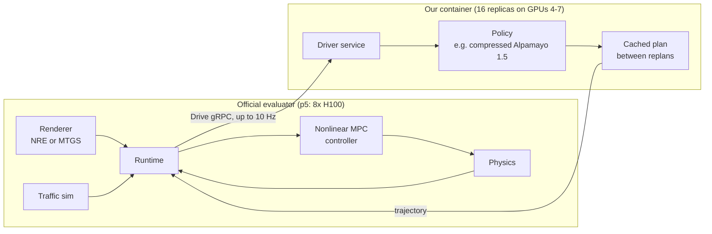

# AlpaSim E2E Closed-Loop Challenge 2026

Our entry for the [AlpaSim E2E Closed-Loop Challenge](https://huggingface.co/spaces/nvidia/AlpasimE2EClosedLoopChallenge2026).
This is a **separate project** from our nuReasoning entry. See [BORROWED.md](BORROWED.md) for
exactly what this repo reuses from nuReasoning, and the rule that governs it.

## The challenge in one screen

We submit a **driver container**. The organisers' simulator renders camera images, calls our
gRPC `Drive` method at up to 10 Hz, feeds our plan to a fixed nonlinear MPC controller, and
the world reacts (closed loop).

| | PAI track | nuPlan track |
|---|---|---|
| Scenes | NVIDIA NuRec neural reconstructions, 9 countries | nuPlan, MTGS gaussian-splat rendering, vehicles only |
| Cameras | 6 at 10 Hz, ~1920x1080 JPEG (Alpamayo's native rig) | 8 at 2 Hz, 1920x1080 (Motional rig, as in nuReasoning) |
| Public local data | `nvidia/PhysicalAI-Autonomous-Vehicles-NuRec` (gated) | `OpenDriveLab/AlpasimChallenge2026_nuplan_track` (491 GB, open) |

**Container contract.**
- Image at most 40 GiB; at most **16 GiB VRAM per replica**.
- 2 concurrent rollouts per replica.
- About 0.1 s of model work per `Drive` call, enforced by a per-track throughput budget.
- No network; read-only root filesystem; `/tmp` 2 GiB.

**Scoring.** Drive-IRT Policy Capability Score, plus average scene score and at-fault distance.

**Limits.**
- **3 scored submissions per rolling 30 days**, shared by both tracks.
- 3 unscored warmups per track per 30 days.
- Leaderboard closes **2026-10-31** (final container choice and 4-page report); results 2026-11-15.

## Where things live

| What | Local | Cluster (`/insomnia001/depts/edu/users/au2327/alpasim`) |
|---|---|---|
| Our code | `src/`, `cluster/`, `patches/` | same names (rsync) |
| Upstream simulator (NVlabs/alpasim, `e2e_challenge` branch) | not vendored | `external/alpasim` |
| Container images (Apptainer SIF) | - | `sif/` |
| Data (nuPlan subset, NuRec scenes) | - | `data/` |
| Runs and logs | - | `runs/`, `logs/` |

Insomnia has no Docker and no Pyxis. The simulator runs from Apptainer images built
by `cluster/alpasim_base.def` (a port of the upstream Dockerfile) and the public NRE
renderer image.

## Status (2026-09-28)

| Item | State |
|---|---|
| Local simulator on Insomnia | works (Apptainer); nuPlan verified, PAI renderer being fixed |
| Driver | `src/a15_driver`: Alpamayo 1.5, int8, no reasoning, replan 2 Hz; 14.5 GiB peak (cap 16 GiB) |
| Image | `teams/amanupg:v0.2-a15int8` (21.5 GB) pushed to ECR |
| Official, Sep slot 1 | PAI, starter: **PCS 1491, rank 38/52** (scene score 0.14; 9,250 of 14,400 s budget) |
| Warmups | nuplan-warmup starter OK (32/32); pai-warmup Alpamayo `ff87a2af…` running |
| Local nuPlan, same 30 scenes | starter 0.687 vs Alpamayo 0.728 mean scene score |

Every measurement and decision is in [LEDGER.md](LEDGER.md).
